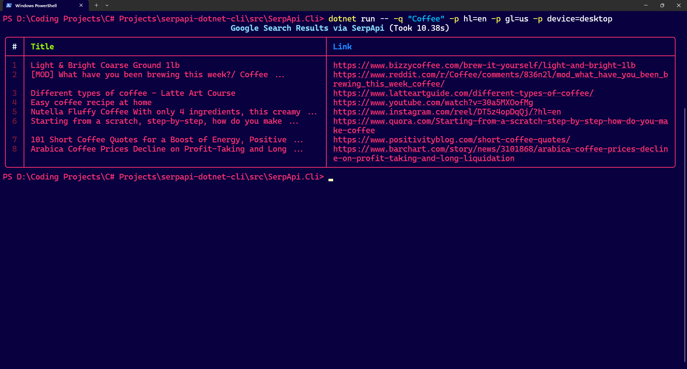

# SerpApi .NET : A modern tool for querying and web scraping

A minimalist, modern command-line based tool for querying SerpApi designed for advanced users who love to use SerpApi for data analyzing and web scraping.



## Getting Started

To get started with this awesome project, you can follow these simple steps:

### Prerequisites

| Prerequisites | Requirement | Purpose |
| ------ | ------ | ------ |
| .NET SDK | .NET 8.0 SDK or later | Compiles and executes the project (`dotnet --version` >= 8.0) |
| Operating System | Windows, macOS or Linux | Cross-platform support |
| Terminal | Any modern terminal with ANSI / UTF-8 support | Renders ANSI colors, spinners, tables... |
| IDE / Editor (Optional) | VS Code, Visual Studio or JetBrains Rider | For development and debugging |

### Installation

1. Clone the repository

2. Install dependencies:

  ```bash
  dotnet restore
  ```

### Simple Usage

To run a query using this program:

1. Navigate to the `SerpApi.Cli` project

  ```bash
  cd src/SerpApi.Cli
  ```

2. Create a `.env` file in the project

  ```env
  SERPAPI_API_KEY="Your SerpApi key here"
  ```

3. Run the command

  ```bash
  dotnet run -- -q "Coffee" -p hl=en -p gl=us
  ```

And there you have it! Your first seach query with this CLI tool!

### More Usage & Examples

- **Basic Search**: `dotnet run -- -q "best coffee"`
- **Localized Search**: Passing language and country codes (`-p hl=km-kh -p gl=kh`)
- **Engine Tuning**: Passing result limits and device views (`-p num=50 -p device=mobile`)
- **Flag Reference Table**:
  - `-q, --query <QUERY>`: Primary search string.
  - `-k, --api-key <KEY>`: Override and set API Key.
  - `-p, --param <PARAM>`: Arbitrary SerpApi key-value parameters.

## Running Test Suite

Tests run completely in-memory using mocked HTTP handlers—no internet connection or SerpApi credits required. To conduct tests for this project, you can use `dotnet test` to test out the functionalities and see if the program is working properly.

### Conducted Tests

See what's already been covered:

1. URL query serialization and deserialization.
2. JSON response mapping to strongly-typed records.
3. Parameter alias normalization (`host_language -> h1`).

## Key Concepts

Quickly grasp the idea behind the software architecture in this project:

- **Dependency Injection**: Instead of tightly coupling classes with `new HttpClient()`, services are registered via `Microsoft.Extensions.DependencyInjection`. This allows commands to depend on abstractions (`ISerpApiClient`), simplifies unit testing with mocks, and manages `HttpClient` lifecycles properly.
- **Typed-Dictionary Parameters**: Instead of manually writing a parameter name like `hl=en` with no type-safety, Parameters are pre-defined as properties in `SearchParameters` class. This simplifies typing by taking the advantage of the C# features, and significantly improving developer experience overall.
